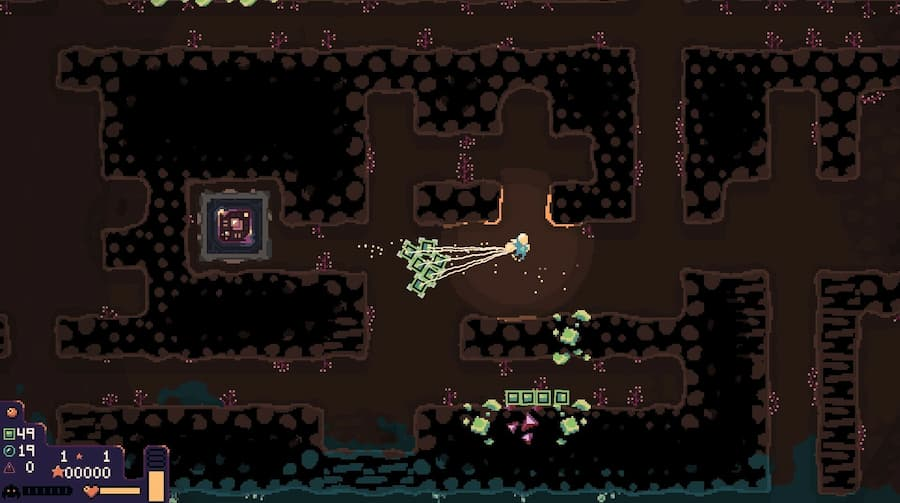
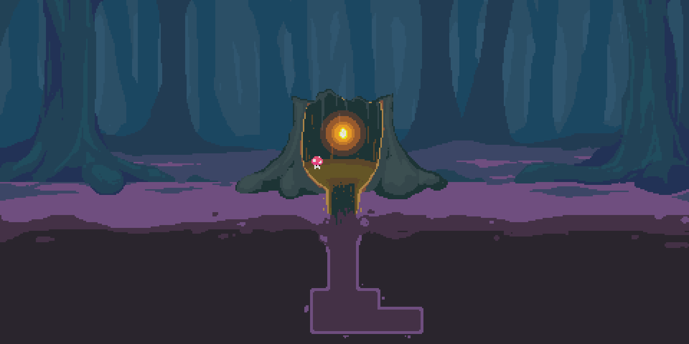
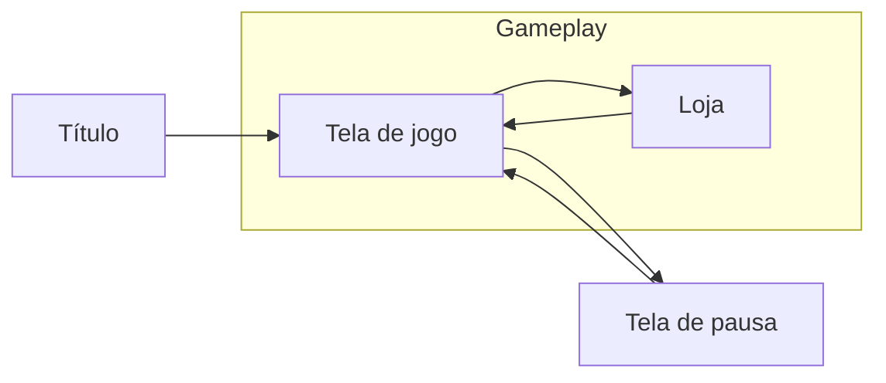

---
tags:
---
# PARTE A: MACRO DESIGN (O QUÊ)

## 1. Capa e controle de versão \[Core\]

| Campo                               | Valor                                                        |
| ----------------------------------- | ------------------------------------------------------------ |
| Título / codinome                   | **Antibiose**                                                |
| Versão do documento                 | 0.1                                                          |
| Data                                | 2026-10-19                                                   |
| Autor(es) e dono do documento       | Caio Bernardo, Aika, João Bruni, Marianna, Caique S.         |
| Status                              | Rascunho                                                     |
| Onde vive (link, wiki, repositório) | https://github.com/ConwayUSP/Prototipo-Disciplina-de-gamedev |

**Histórico de mudanças**

| Versão | Data       | Autor         | O que mudou       | Por quê |
| ------ | ---------- | ------------- | ----------------- | ------- |
| 0.1    | 2026-10-19 | Caio Bernardo | Primeiro rascunho |         |

## 2. Visão geral \[Core\]

**2.1 Elevator pitch (máximo 4 frases).**
Interprete um cogumelo defendendo a semente da floresta, de dia colete recursos e melhore seus equipamentos, de noite, enfrente os fungos mortos vivos. Sobreviva o quanto puder e busque salvar a floresta. Esse projeto é um **exercício programa de exemplo** para a disciplina *ACH2179 - Desenvolvimento de Jogos* da Universidade de São Paulo, feito em parceria com a Liga Acadêmica Conway USP.

**2.2 Fantasia central / experiência-alvo.** 
Um ambiente acolhedor de dia, que de noite se torna perigoso e intimidador, o jogador deve gerenciar seus recursos e seu tempo enquanto corre para vencer o jogo.

**2.3 Pilares de design (3 a 5)**

| Pilar                          | O que significa              | Nos faz dizer SIM a | Nos faz dizer NÃO a |
| ------------------------------ | ---------------------------- | ------------------- | ------------------- |
| Boa organização e Documentação | seguir o reteiro             |                     |                     |
| Jogos simples e fácil          | Isso é um projeto de exemplo |                     |                     |

**2.4 Ficha do jogo**

| Item                                                | Descrição                    |
| --------------------------------------------------- | ---------------------------- |
| Gênero                                              | Roguelike                    |
| Perspectiva / câmera                                | Sideview                     |
| Plataformas e requisitos de entrada                 | PC-only                      |
| Modos (solo, 2 jogadores alternados, co-op, versus) | solo                         |
| Público-alvo e classificação indicativa             | livre para todos os públicos |
| Duração da campanha e da sessão típica              | curta (máx. 1 hora)          |
| Modelo de negócio                                   | N/A                          |

**2.5 Referências e diferenciais.**
- **Dome Keeper**: principal inspiração das mecânicas do jogo (hordas, mineração, upgrades, etc).

Fig 1. Ft. DomeKeeper (Imagem de referência)

- **MushRooms**: design artístico e nosso protagonista *Mush*.

Fig 2. Estilo de Arte pensado.

**2.6 Metas.**
- De experiência:
	- Jogador deve se divertir e querer jogar o jogo de novo querendo acabá-lo mais rápido
- De produção:
	- Ótima documentação e organização para servir de referência a Disciplina ACH2179 e à Conway USP.

## 3. Escopo e prioridades \[Core\]

**3.1 Conteúdo em números.**
- 1 personagem jogável
- 3 recursos principais (ambar, cristal e musgo)
- 1 item capaz de zerar o jogo
- min. 3 inimigos únicos
- 1 mundo limitado gerado proceduralmente

**3.2 Incluído vs NÃO planejado**

| Incluído                  | NÃO planejado                    | Desejável (wish list)        |
| ------------------------- | -------------------------------- | ---------------------------- |
| HUD e interface diegêsica | animações e recursos complexos   | diferentes tamanhos de mundo |
|                           | Durabilidade variadas dos blocos |                              |
|                           | Mais de um personagem jogável    |                              |

**3.3 Matriz de features.** *Classifique cada feature. Alto risco com baixo retorno sai do escopo; o design está bom quando não há mais nada a cortar.*

| Feature                               | Valor (1 a 10) | Retorno (Competitivo / Estratégico / Polimento) | Risco (Livre / Compromisso / Experimento) | Decisão (Fazer / Protótipo / Depois / Cortar) |
| ------------------------------------- | -------------- | ----------------------------------------------- | ----------------------------------------- | --------------------------------------------- |
| sprites animadas                      |                |                                                 |                                           |                                               |
| intefaces diegéticas e não diegéticas |                |                                                 |                                           |                                               |
| detecção e triggers de colisão        |                |                                                 |                                           |                                               |
| shaders                               |                |                                                 |                                           |                                               |
| simulação física                      |                |                                                 |                                           |                                               |
| IA em inimigos                        |                |                                                 |                                           |                                               |
| Geração procedural                    |                |                                                 |                                           |                                               |
| sistema baseado em eventos            |                |                                                 |                                           |                                               |
| SFX                                   |                |                                                 |                                           |                                               |
| ciclo de dia/noite                    |                |                                                 |                                           |                                               |
> [!warning] N/A
> A parte de classificação foi ignorada pois as *features* já estão todas previamente definidas com base no plano de aulas da disciplina optativa de jogos.

**3.4 Restrições.**
- Prazo de 4 meses (nov, dez, jan, fev)
- equipe pequena/média (4 a 10 pessoas)
- Deve ser documentado e organizado de forma didática
## 4. Estrutura e fluxo de jogo \[Core\]

**4.1 Loop principal.**
- Ciclo de dia:
	- minerar solos -> coletar recurso -> melhorar equipamentos
	- Buscar pelo item mágico que permite zerar o jogo
- Ciclo de noite:
	- atacar inimigos -> reparar o tronco

**4.2 Progressão macro.**
- Jogador escava por recursos, leva os até sua mesa de trabalho para melhorar seus equipamentos e buscar o item que zera o jogo. Recursos são escassos e o item está nas profundezas do mapa.
- Jogador presta atenção ao ciclo de dia e noite para impedir os inimigos de destruir a semente sagrada. Hordas ficam cada vez mais numerosas.

**4.3 Vitória, derrota e fim de jogo.**
- O jogo é uma corrida contra o tempo, a vida do jogador é representada pela vida da semente, caso ela chegue a zero o jogo acaba, o personagem em si não tem vida
- Ao reunir o item mágico com a semente sagrada, o jogo se encerra.

**4.4 Sessão de exemplo.**
Jogador, começa minerando para baixo e coletando os recursos que coletar no caminho, quando o dia termina ele corre para a superfície, interage com sua mesa de trabalho, abre a UI de melhora de equipamentos, troca para o modo de combate e começa a defender o tronco contra os inimigos utilizando uma arma de longo de alcance, até que a noite acaba.

**4.5 Modos de jogo.**
Apenas solo.

## 5. História, mundo e tom \[Core, ou N/A em jogos abstratos\]

- **5.1 Sinopse.**
 o cogumelinho *Mush* deve proteger a árvore de fungos malvados. A árvore é o coração da floresta e mantém ela viva, o cogumelinho deve protegê-la a todo custo de monstros enquanto coleta seus recursos para se proteger, alimentar e lutar.
- **5.2 Setting.**
Floresta mágica em decadência, tom tranquilo e suave de dia, sombrio e assustador de noite.
- **5.3 Protagonista e motivação.** 
Protagonista é o cogumelo *Mush*. motivação é o Mutualismo: a árvore provém recursos mágicos ao cogumelinho e o cogumelinho a protege.
- **5.4 Estrutura narrativa.** 
Expositiva, não haverá elementos de escrita ou texto que introduza a história ao jogador, apenas elementos visuais que sugiram a narrativa. 
- **5.5 Entrega da história.**
O jogador deve tirar suas próprias conclusões.

---

# PARTE B: MICRO DESIGN (O COMO)

## 6. Ficha padrão de sistema ou feature \[Core, repita para cada sistema\]

| Campo                                            | Conteúdo                                                                                                                 |
| ------------------------------------------------ | ------------------------------------------------------------------------------------------------------------------------ |
| Nome                                             | Ciclo de Dia e Noite                                                                                                     |
| Objetivo (experiência que entrega ao jogador)    | Marca a dinâmica de coleta de recurso vs. combate do jogador                                                             |
| Como funciona                                    | o jogo começa no inicio do dia e progredi para a noite (onde inimigos atacam) e aparecem até o final da noite.           |
| Regras e números (parâmetros, fórmulas, tabelas) | 24 horas no jogo se traduzem para 10 minutos no jogo (5 min de dia e 5 de noite).                                        |
| Entradas e controles                             | N/A                                                                                                                      |
| Feedback (visual, sonoro, UI)                    | O cenário da superfície muda conforme o horário do dia, claro -> escuro -> claro, bem como pode haver uma HUD de horário |
| Casos de borda e falhas                          | N/A                                                                                                                      |
| Dependências (sistemas e tecnologia)             | Relógio global                                                                                                           |
| Em escopo / fora de escopo                       | ...                                                                                                                      |
| Critério de aceite (como testar)                 | ciclo de dia de noite visual e dentro do tempo estabelecido, noite ativa sinal de horda e monstros                       |
| Responsável e status                             | pendente                                                                                                                 |

| Campo                                            | Conteúdo                                                                                                                                           |
| ------------------------------------------------ | -------------------------------------------------------------------------------------------------------------------------------------------------- |
| Nome                                             | Troca de modos de jogo                                                                                                                             |
| Objetivo (experiência que entrega ao jogador)    | levar o jogador de um modo para o outro (coleta, combate, upgrade)                                                                                 |
| Como funciona                                    | ao interagir com uma mesa de trabalho o jogador pode trocar de modos de jogo (coletador/combate/ui de upgrades) de modo organizado                 |
| Regras e números (parâmetros, fórmulas, tabelas) | assim como no Dome Keeper original, o mundo 'pausa' (nada se mexe, inclusive inimigos) enquanto a UI está aberta, 3 opções selecionáveis aparecem. |
| Entradas e controles                             | botão principal de interação (`a`/`<Espaço>`?)para abrir a UI, e outras 3 teclas para os modos de jogo (setas? números?)                           |
| Feedback (visual, sonoro, UI)                    | bancada de trabalho, cotoco do tronco, ou até a própria semente da floresta.                                                                       |
| Casos de borda e falhas                          | dependendo do componente o game loop ainda precisa rodar enquanto o jogador decide sua escolha.                                                    |
| Dependências (sistemas e tecnologia)             | precisa interagir (ou sinalizar) com os outros sistema para congelá-los (fisica, dia/noite, inimigos, etc)                                         |
| Em escopo / fora de escopo                       | mais de 3 modos de jogo                                                                                                                            |
| Critério de aceite (como testar)                 | jogador pode acessar a interface, pausando o mundo por completo e pode trocar entre os 3 modos de jogo                                             |
| Responsável e status                             | pendente                                                                                                                                           |

| Campo                                            | Conteúdo                                                                                                                                                                                                                                                                                                                               |
| ------------------------------------------------ | -------------------------------------------------------------------------------------------------------------------------------------------------------------------------------------------------------------------------------------------------------------------------------------------------------------------------------------- |
| Nome                                             | Spawn de monstros                                                                                                                                                                                                                                                                                                                      |
| Objetivo (experiência que entrega ao jogador)    | Inimigos geram durante a noite com o objetivo de atacar o coração da floresta                                                                                                                                                                                                                                                          |
| Como funciona                                    | uma quantidade de inimigos aparece nas bordas do mundo em direção ao centro, ao chegar no tronco eles o atacam, podem ser mortos pelo jogador                                                                                                                                                                                          |
| Regras e números (parâmetros, fórmulas, tabelas) | Quanidade de inimigos aumenta a cada noite em uma proporção $2 \times dia$, o tipo de inimigos pode ser randomizado, a distribuição também dos que vem pela direita e esquerda pode ser randomizada. Sua IA pode ser tão simples quanto ir para frente, outros podem ter movimentos complexos para se esquivar dos ataques do jogador. |
| Entradas e controles                             | N/A                                                                                                                                                                                                                                                                                                                                    |
| Feedback (visual, sonoro, UI)                    | Animação de caminhada, ataque, dano e morte, bem como efeitos sonoros                                                                                                                                                                                                                                                                  |
| Casos de borda e falhas                          | Inimigos ficarem presos e cantos indesejados ou não se movimentarem corretamente. Atacar uma estrutura também pode se tornar complicado                                                                                                                                                                                                |
| Dependências (sistemas e tecnologia)             | Sistema de spawn e pathfiding, depende de nós especificos do Godot                                                                                                                                                                                                                                                                     |
| Em escopo / fora de escopo                       | ...                                                                                                                                                                                                                                                                                                                                    |
| Critério de aceite (como testar)                 | Spawn de inimigos pode ser configurado por meio de entradas, eles aparecem nos cantos do mundo e realizam seus padrões de ataque.                                                                                                                                                                                                      |
| Responsável e status                             | pendente                                                                                                                                                                                                                                                                                                                               |

| Campo                                            | Conteúdo                                                                                                                                                                |
| ------------------------------------------------ | ----------------------------------------------------------------------------------------------------------------------------------------------------------------------- |
| Nome                                             | Sistema de upgrades                                                                                                                                                     |
| Objetivo (experiência que entrega ao jogador)    | permite que o jogador melhore seus atributos com os recursos coletados                                                                                                  |
| Como funciona                                    | sistema de árvore de progressão, diversos caminhos de melhoria, cada melhoria possui um custo e desbloqueia outros recursos                                             |
| Regras e números (parâmetros, fórmulas, tabelas) | cada upgrade tem um custo fixo usando os recursos coletados, quantidade necessária progredi com os upgrades                                                             |
| Entradas e controles                             | mouse para desbloquear o upgrade                                                                                                                                        |
| Feedback (visual, sonoro, UI)                    | melhorias bloqueadas são cinzas e um motivo aparece na tela (recursos insuficientes, bloqueada). Inspiração na Figura 3                                                 |
| Casos de borda e falhas                          | ...                                                                                                                                                                     |
| Dependências (sistemas e tecnologia)             | Acesso ao inventário e atributos do jogador                                                                                                                             |
| Em escopo / fora de escopo                       | dentro:  ataque, velocidade, velocidade de mineração, reparo do tronco, tamanho do inventário / fora: várias árvores de progressão complexas, balanceamento de recursos |
| Critério de aceite (como testar)                 | jogador pode comprar os upgrades c                                                                                                                                      |
| Responsável e status                             | pendente                                                                                                                                                                |
![[Pasted image 20261020145928.png]]
Fig. 3. Upgrades no DomeKeeper

| Campo                                            | Conteúdo                                                                                                                                                                                                                                                    |
| ------------------------------------------------ | ----------------------------------------------------------------------------------------------------------------------------------------------------------------------------------------------------------------------------------------------------------- |
| Nome                                             | Escavação, coleta de recursos                                                                                                                                                                                                                               |
| Objetivo (experiência que entrega ao jogador)    | permitir coletar recursos para upgrades e zerar o jogo                                                                                                                                                                                                      |
| Como funciona                                    | O subterrâneo é um mapa finito gerado proceduralmente                                                                                                                                                                                                       |
| Regras e números (parâmetros, fórmulas, tabelas) | Dividido em blocos, alguns desses blocos possuem recursos enterrados que dropam como itens ao quebrá-los. O jogador pode adicioná-los ao seu inventário caso possível. Um item especial está em alguma posição profunda do mapa que permite encerrar o jogo |
| Entradas e controles                             | tecla principal para quebrar blocos de terra, botão secundário para adicionar a carga                                                                                                                                                                       |
| Feedback (visual, sonoro, UI)                    | O solo é composto de blocos unitários de terra, blocos não quebráveis são visualmente diferentes, itens caem no chão e são afetados pela física.                                                                                                            |
| Casos de borda e falhas                          | Limites do mundo, o chão não pode chegar na superfície e nem passar dos limites                                                                                                                                                                             |
| Dependências (sistemas e tecnologia)             | Inventário do jogador, geração de terreno, recursos                                                                                                                                                                                                         |
| Em escopo / fora de escopo                       | Fora de escopo: blocos com durabilidade diferentes                                                                                                                                                                                                          |
| Critério de aceite (como testar)                 | Jogador pode cavar para baixo e coletar recursos                                                                                                                                                                                                            |
| Responsável e status                             | pendente                                                                                                                                                                                                                                                    |

| Campo                                            | Conteúdo                                                           |
| ------------------------------------------------ | ------------------------------------------------------------------ |
| Nome                                             | Sistema de combate                                                 |
| Objetivo (experiência que entrega ao jogador)    | eliminar os monstros atacando o tronco                             |
| Como funciona                                    | o jogador possui um arco ou estilingue capaz de disparar projéteis |
| Regras e números (parâmetros, fórmulas, tabelas) |                                                                    |
| Entradas e controles                             | mirar com o mouse e disparar com botão esquerdo                    |
| Feedback (visual, sonoro, UI)                    | uma mira acompanha                                                 |
| Casos de borda e falhas                          |                                                                    |
| Dependências (sistemas e tecnologia)             |                                                                    |
| Em escopo / fora de escopo                       |                                                                    |
| Critério de aceite (como testar)                 |                                                                    |
| Responsável e status                             | pendente                                                           |
## 7. Mecânicas e controles \[Core\]

**7.1 Mecânica central.**

Movimentar, cavar / mirar e atirar

**7.2 Controles por contexto**

| Ação                     | Gamepad | Teclado e mouse                                                           | Toque | Contexto (a pé, veículo, menu) | Observações |
| ------------------------ | ------- | ------------------------------------------------------------------------- | ----- | ------------------------------ | ----------- |
| Mover-se/planar          | N/A     | setas                                                                     | N/A   |                                |             |
| mirar/atirar             | N/A     | mouse botão esquerdo                                                      | N/A   |                                |             |
| cavar                    | N/A     | `x`                                                                       | N/A   |                                |             |
| pegar item/interagir     | N/A     | `z`/`espaço`                                                              | N/A   |                                |             |
| selecionar zmodo de jogo | N/A     | seta esquerda (combate), seta para cima (upgrade), seta direita (minerar) | N/A   |                                |             |
| sair de um menu          | N/A     | `q`                                                                       | N/A   |                                |             |
| pausar e voltar          | N/A     | `<esc>`                                                                   | N/A   |                                |             |

**7.3 Movimento e física.**
Semi-realista. Possui gravidade e colisão, aplicada a itens, aos inimigos e jogador.

**7.4 Combate.**
Jogador ataque por meio de projéteis. Alcance do jogador é ilimitado (?), projéteis causam dano por contato.
Inimigos causam dano por contato e miram no "domo"/tronco de proteção.

**7.5 Dano, saúde e recuperação**

O tronco toma dano dos inimigos, pode ser reparado na lojinha. Os inimigos tomam dano pelos projéteis do jogador. personagem em si não toma dano.

Neste jogo não haverá efeitos (por enquanto).

| Estado | Saúde | Como se ganha | Como se perde | Efeito |
| ------ | ----- | ------------- | ------------- | ------ |
|        |       |               |               |        |

**7.6 Pontuação e recompensas**

| Evento               | Pontos ou recompensa         | Condição                        |
| -------------------- | ---------------------------- | ------------------------------- |
| Coletar recurso/item | adiciona o item o inventário | estar dentro do alcance do item |

**7.7 Economia \[Opcional\].**
Upgrades podem ser comprados por recursos, a quantidade de recursos depende do nível do upgrade.
## 8. Sistemas gerais \[Core / Opcional\]

- **8.1 Sistemas globais \[Core\].**
Sem sistema de saving. Tutorial por meio de um menu de ajuda. Sistema de pausa.
- **8.2 Progressão do personagem.**
Personagem pode melhorar sua velocidade, tamanho do inventário, dano da arma, (alcance?), recuperar e reforçar o tronco.
- **8.3 Customização \[Opcional\].** 
Não planejado.
- **8.4 Itens, armas e coletáveis \[Core\].**

| Imagem | Nome                       | Efeito | Raridade e onde aparece | Observações |
| ------ | -------------------------- | ------ | ----------------------- | ----------- |
|        | musgo                      | N/A    | comum, subsolo          |             |
|        | raizes                     |        | comum, subsolo          |             |
|        | seiva                      | N/A    | incomum, subsolo        |             |
|        | cristal                    | N/A    | raro, subsolo           |             |
|        | item capaz de zerar o jogo | N/A    | único, subsolo          |             |

- **8.5 Lojas e hub \[Opcional\].** 
A base do jogador possui é o alvo de ataque dos monstros e mesa de trabalho para upgrades e se defender.
- **8.6 Multiplayer e co-op \[Opcional\].**
	N/A
- **8.7 Geração procedural e expansibilidade \[Opcional\].**
Geração procedural envolta da forma do mapa e da disposição dos recursos no subterrâneo.
- **8.8 Atividades e diversões opcionais \[Opcional\].**
	N/A

## 9. Personagens, inimigos e IA \[Core\]

**9.1 Ficha de personagem jogável**

| Campo                                | Conteúdo                                                                       |
| ------------------------------------ | ------------------------------------------------------------------------------ |
| Nome, idade, aparência               | *Mush*, um cogumelinho                                                         |
| Personalidade e história             | o herói, criado pela semente mágica e rede de micélio para proteger a floresta |
| Vantagens                            | Consegue subir em paredes                                                      |
| Desvantagens                         | Nenhuma                                                                        |
| Habilidades iniciais                 | Minerar, disparar projéteis, coleta itens                                      |
| Variações visuais (cor, equipamento) | N/A                                                                            |

**9.2 Catálogo de inimigos e NPCs**

| Imagem | Nome                | Papel          | Comportamento                           | Como derrotar (forças e fraquezas) | Vida | Dano | Recompensa | Onde aparece |
| ------ | ------------------- | -------------- | --------------------------------------- | ---------------------------------- | ---- | ---- | ---------- | ------------ |
|        | Fungos malvados     | Inimigo base   | marcham em direção ao tronco e o atacam | Ataque básico                      | 10   | 3    | N/A        |              |
|        | Coruja de infectada | Inimigo voador | ataques razantes                        | Ataque básico                      | 15   | 3    | N/A        |              |
|        | Mega fungo          | Inimigo pesado | ataque pesado                           | Ataque básico                      | 20   | 5    | N/A        |              |

**9.3 Chefes.**
> [!warning] N/A
> O jogo terá chefes, apenas hordas maiores de inimigos.

**9.4 IA**

> [!warning] N/A
> Será planejado em outro momento

| Grupo | Comportamento | Movimento | Percepção | Reação a estímulos |
| ----- | ------------- | --------- | --------- | ------------------ |
|       |               |           |           |                    |

*Inclua diagramas de movimento, regras de spawn e ferramentas de script. IA simples e previsível ajuda o jogador a aprender.*

**9.5 Aliados e companheiros \[Opcional\].**
> [!warning] N/A
> Não haverá companheiros ao jogador
## 10. Níveis e missões \[Core\]

> [!warning] N/A
> O jogo consiste de uma única missão e não possui níveis por isso essa seção foi ignorada.

**10.1 Princípios de level design.** *Simplicidade, variação (cenário, inimigos, ritmo), curva de dificuldade, ensino progressivo (o primeiro nível ensina as regras).*

**10.2 Estrutura de níveis.** *Diagrama ou tabela de mundos e áreas, com o tipo de cada uma (superfície, subterrâneo, água, castelo ou chefe).*

**10.3 Tipos de ambiente**

| Tipo | Visual | Regras especiais | Música | Inimigos típicos |
| ---- | ------ | ---------------- | ------ | ---------------- |
|      |        |                  |        |                  |

**10.4 Ficha padrão de nível ou missão (copie para cada uma)**

| Campo                          | Conteúdo |
| ------------------------------ | -------- |
| Nome e ID                      |          |
| Resumo                         |          |
| Objetivos                      |          |
| NPCs obrigatórios e opcionais  |          |
| Local                          |          |
| Briefing (cinemática ou texto) |          |
| Preparação                     |          |
| Execução                       |          |
| Finalização                    |          |
| Condições de falha             |          |
| Recompensas                    |          |
| Notas                          |          |
| Mapa ou layout (imagem)        |          |

**10.5 Capítulos ou episódios.** *Se o jogo for dividido, repita por capítulo: história, atores, particularidades e mapas (estrutura do Doom Bible).*

## 11. Interface e experiência do usuário \[Core\]

**11.1 Fluxograma de telas.** 

**11.2 Hierarquia de telas**

| Tela                   | Propósito                  | Elementos                                           | Entradas                           | Próxima tela                    |
| ---------------------- | -------------------------- | --------------------------------------------------- | ---------------------------------- | ------------------------------- |
| Título (com demo loop) | Iniciar o jogo             | Título e botão de jogo                              | `<Enter>`, mouse                   | Gameplay                        |
| Pausa                  | fechar e resumir o jogo    | botão de sair do jogo                               | mouse                              | Gameplay / Menu / Tela de ajuda |
| Gameplay               | o jogo em si               | Todos os elementos do jogo                          | setas, teclas de ação, mouse       |                                 |
| Loja de upgrades       | Conseguir upgrades         | caminhos de upgrades, descrições e função de compra | mouse                              | Gameplay                        |
| Game over              | Mostra o resultado do jogo | Duração da run                                      | Botão de voltar ao menu, `<Enter>` | Título                          |
| Tela de ajuda          | tutorial do jogo           | fluxograma e imagem explicando como jogar o jogo    | Botão de voltar                    | Pausa                           |

**11.3 HUD**

| Elemento               | Informação                                           | Posição        | Quando aparece |
| ---------------------- | ---------------------------------------------------- | -------------- | -------------- |
| Relógio                | mostrar o ciclo de dia e noite                       | canto inferior | sempre         |
| quantidade de recursos | lista de icone com quantidade do determinado recurso | canto inferior | sempre         |
| vida do tronco         | barra de vida indicando o estado do tronco           | canto inferior | sempre         |

**11.4 Menus e opções.** 

> [!warning] N/A
> Opções de configurações ficam não planejadas até um próximo momento.

**11.5 Feedback e tutorial.** 

Tela de ajuda, acessível pela tela de pausa, mostrando os principais comandos e ações.

Mensagens de erro e feedback visual por meio de interfaces diegésicas (iluminação, cores e animações) precisam estar bem presentes no jogo.

## 12. Arte, áudio e cinemáticas \[Core\]

**12.1 Direção de arte.**
Pixel art 2D, cores simples, animadas que combinem com o clima mágico e agitado do jogo. Deve também ter uma certa "fofura" no personagens, formas e itens.

**12.2 Lista de assets**

> [!warning] N/A
> A lista de assets será feita na etapa de desenvolvimento do projeto.

| Categoria | Quantidade | Animações e variações (ex.: 8 direções, nº de frames) | Prioridade | Status |
| --------- | ---------- | ----------------------------------------------------- | ---------- | ------ |
|           |            |                                                       |            |        |
|           |            |                                                       |            |        |
|           |            |                                                       |            |        |

**12.3 Áudio.**
- Efeitos:
	- mover-se
	- quebrar bloco
	- ataque do jogador, ataque do inimigo
	- dano no inimigo, dano no tronco
	- interagir com itens
- Música: tema principal, música de dia (tranquila e aventureira), música de noite (agitada, tensa)

**12.4 Cinemáticas e telas especiais.**
- Tela inicial
- Superficie
- Subterrâneo
- Tela final
- Tela de pausa

---

# PARTE C: PRODUÇÃO E NEGÓCIO

## 13. Análise técnica \[Core\]

- **13.1 Plataforma e especificações.**
	- Jogo de PC (mobile não planejado)
	- Sprites serão feitas pelos designers
	- Aúdios e SFX podem ser feitos pelos designers ou de terceiros
- **13.2 Engine e ferramentas.** 
	- Godot Engine e GDScript como *engine* e linguagem de programação principais
- **13.3 Sistemas técnicos críticos.**
	- Jogo local
	- IA básicas
	- Física básica
	- Geração procedural na criação de terrenos
- **13.4 Metas de desempenho.** 
	- Rápido o suficiente para ser jogável. 
- **13.5 Parâmetros de debug e cheats.** 
	- N/A
- **13.6 Onde simular.**
	- N/A

## 14. Plano de desenvolvimento \[Core\]

> [!warning] N/A
> O plano de desenvolvimento deste GDD será organizado em outro documento, em momento oportuno.
 
**14.1 Equipe e papéis**

| Papel        | Quantidade | Responsável      |
| ------------ | ---------- | ---------------- |
| Design       | todos      | Todos            |
| Programação  | 3 a 4      | Caio, João, ?    |
| Arte         | 3 a 4      | Aika, João, ?    |
| Áudio        | a definir  | a definir        |
| QA           | todos      | Todos            |
| Documentação | 2          | Marianna, Caique |

**14.2 Cronograma e marcos**

| Disciplina            | M1  | M2  | M3  | M4  | M5  | M6  | M7  | M8  | M9  | M10 | M11 | M12 |
| --------------------- | --- | --- | --- | --- | --- | --- | --- | --- | --- | --- | --- | --- |
| Design                |     |     |     |     |     |     |     |     |     |     |     |     |
| Programação           |     |     |     |     |     |     |     |     |     |     |     |     |
| Arte                  |     |     |     |     |     |     |     |     |     |     |     |     |
| Áudio                 |     |     |     |     |     |     |     |     |     |     |     |     |
| Teste e balanceamento |     |     |     |     |     |     |     |     |     |     |     |     |

**14.3 Ordem de implementação.** *Ex.: interface, núcleo, estrutura e geradores, conteúdo, polimento. Comece o polimento cedo.*
 

**14.4 Riscos**

| Risco | Probabilidade | Impacto | Mitigação | Dono |
| ----- | ------------- | ------- | --------- | ---- |
|       |               |         |           |      |

**14.5 Estimativas.** *Desconfie de estimativas longas e de features empolgantes (tendem a ser subestimadas ou superestimadas). Separe funcional de completo e agrupe features parecidas em lotes.*

**14.6 Stakeholders**

| Pessoa ou papel | Interesse                                               | Pode vetar? | Canal de comunicação |
| --------------- | ------------------------------------------------------- | ----------- | -------------------- |
| Prof. JB        | proponente da disciplina em que o projeto está inserido | Sim         | Whatsapp             |
| Conway USP      | organização apoiadora do projeto                        | Talvez      | Discord/Telegram     |

## 15. Playtest e iteração \[Core\]

> [!warning] N/A
> Fase de testes será feita durante o desenvolvimento do projeto entre os jogadores e futuramente com os alunos da disciplina.

**15.1 Plano de playtest.** *O que testar, quando, com quem. Métricas: taxa de conclusão, mortes por área, tempo por fase.*

**15.2 Regras.** *Observe o que o jogador FAZ, não só o que diz. Procure o insight por trás da sugestão. Se um design falhar na implementação, redesenhe ou corte.*

**15.3 Registro de feedback**

| Data | Build | Observação | Insight | Ação | Status |
| --- | --- | --- | --- | --- | --- |
|  |  |  |  |  |  |

---
## Checklist final de qualidade

- [x] Elevator pitch em até 4 frases  [completion:: 2026-10-19]
- [x] Cada seção cabe em cerca de 1 página, ou foi dividida  [completion:: 2026-10-20]
- [x] Ideias importantes têm imagem, diagrama ou mockup  [completion:: 2026-10-19]
- [x] Incluído e NÃO planejado definidos  [completion:: 2026-10-19]
- [x] Matriz de features preenchida  [completion:: 2026-10-19]
- [x] Ficha de sistema criada para cada mecânica  [completion:: 2026-10-20]
- [x] Riscos e stakeholders mapeados  [completion:: 2026-10-20]
- [x] Plano de playtest definido  [completion:: 2026-10-20]
- [x] Versão e histórico de mudanças atualizados  [completion:: 2026-10-20]
